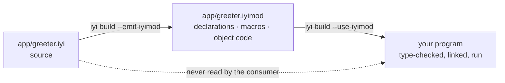

# iyi

[](https://github.com/iyilang/iyi/actions/workflows/iyi.yml)
[](LICENSE)
[](https://iyi.dev)
[](https://packs.iyi.dev/)

**A language built for Developer & Agentic Experience, Portability, Performance,
and Efficiency.** (*iyi* is Turkish for "good".)

Install the latest release into `~/.local` (Linux x86-64, macOS arm64):

```sh
curl -fsSL https://raw.githubusercontent.com/iyilang/iyi/master/install.sh | sh
~/.local/bin/iyi run ~/.local/share/iyi/samples/hello.iyi
```

On Windows x86-64, with the Visual C++ build tools installed
([Getting it](#getting-it) says why):

```powershell
irm https://raw.githubusercontent.com/iyilang/iyi/master/install.ps1 | iex
& "$env:LOCALAPPDATA\Programs\iyi\bin\iyi.exe" run "$env:LOCALAPPDATA\Programs\iyi\share\iyi\samples\hello.iyi"
```

Those four are one design decision seen from four sides. A module is the unit of
compilation and it is compiled against its dependencies' **declarations**, never
their bodies — so a build reads less, a program carries less, a tool can read an
interface without a repository, and a person waits less.

| | measured today |
|---|---|
| **Developer experience** | edit one module in a 7,207-line project and rebuild: **0.13 s**, against Crystal's 1.17 s and `go build`'s 0.16 s |
| **Agentic experience** | `iyi mod context` hands an edit the exact surface of every import at **52–59%** of the sources' size, and a model writing against it spent **31–43% fewer prompt tokens** (`bench/context_pack.py`, AI_FIRST.md §5) |
| **Portability** | an iyi program compiles for **nine targets** and is **run** on five of them every build: x86-64 glibc, x86-64 musl, aarch64 under emulation, wasm32-wasi under wasmtime, and aarch64-darwin natively |
| **Performance** | native code through LLVM, and a front end that answers `hello` in **0.034 s**. At run time the two libraries are within noise where they do the same work |
| **Efficiency** | that `hello` is a **36 KB** binary that starts in **1.6 ms**; the same program with Crystal's library is 1,553 KB and 3.2 ms |

**iyi is its own language, and it is compatible with
[Crystal](https://crystal-lang.org).** The same compiler builds `.cr` files,
`iyi build --crystal` gives a program Crystal's standard library, and
`require "kemal"` in an iyi file serves HTTP. A `.iyi` file also has rules
Crystal does not have and refuses things Crystal accepts, and those rules are
the whole of what follows. The compiler is built on Crystal's, which is
recorded in the [licence](LICENSE) and [NOTICE.md](NOTICE.md).

## The edit loop

One script writes the same program three times, in iyi, in Crystal and in Go:
**30 modules**, 10 types each, **7,207 lines**, and one `main` that calls all
thirty and prints the total. The benchmark changes a single number in one
function of one module, then rebuilds. One of the thirty, as iyi, with nine of
its ten types left out:

```crystal
module parts/mod0

pub struct Widget0
  @a : Int32
  @b : Int32

  def initialize(@a : Int32, @b : Int32)
  end

  def score : Int32
    ((@a * 3) + (@b * 5)) % 1000
  end

  def blend(other : Widget0) : Int32
    (score + other.score) % 1000
  end
end

pub def total0 : Int32
  edit_point = 0            # the line the benchmark changes, then rebuilds
  w0 = Widget0.new(0, 0)
  (edit_point + w0.score + w0.blend(w0)) % 100000
end
```


<sup>The bars run in real time, and `…` is `--use-iyimod mods --emit-iyimod mods`.
Drawn by the run that measured it: `python3 bench/incremental.py --svg doc/assets/edit-loop.anim.svg`.</sup>

The Crystal column is this same compiler under the one rule iyi drops. A
Crystal class is open until the last line of the last file, so no build may
trust anything it read last time, and every rebuild reads all 7,207 lines
again. Take that rule away and the line you just changed costs **9x less**.
`bench/incremental.py` refuses to start the clock until all three programs
print the same total.

The design is in [SPEC.md](SPEC.md), which records what was measured, what was
thrown away and why. Every number in this README names the command that prints
it.

**Where it loses, and what is young:**

- A full build of 6,912 never-seen lines is 0.24 s against `go build`'s 0.09 s.
- iyi's own prelude is the small-tool floor — `puts`, stdin, whole-file
  `File`, `Program.args`/`.env` — and no more. Sockets, format strings and
  TLS are opt-in modules (`import std/socket`, `std/format`, `std/tls`).
  `std/tls` has not been audited and is not to be called secure until it is;
  [SECURITY_REVIEW_TLS.md](SECURITY_REVIEW_TLS.md) is an automated review,
  not that audit.
- Concurrency (`group`/`spawn`, `spawn_parallel`, `Channel`, cancellation;
  SPEC.md III.4) runs on Linux (x86_64, aarch64), macOS arm64 and Windows
  x86-64, and not on wasm32.
- Dependencies resolve and pin (`iyi.mod`, `iyi get`, `iyi.sum`; SPEC.md
  III.7), but there is no registry and no artifact distribution yet, and
  `--crystal` still leans on shards.

## The program that makes the argument

A web framework's DSL, with the Sinatra feel intact. The library exports names.
The program picks which ones it wants unqualified. Nothing gets injected into
anybody's namespace.

```crystal
module samples/webapp

import kemal/dsl::*                    # get, post, mount: because this file asked
import kemal/router::{Router, Context}

get "/" do |env|
  "home"
end

get "/count" do |env|
  42                                   # anything implementing IntoBody, not just String
end

users = Router.new
users.namespace "/admin" do |admin|
  admin.get "/dashboard" do |env|
    "dashboard"
  end
end

mount "/v1", users
```

That file is [`samples/iyi/webapp.iyi`](samples/iyi/webapp.iyi), a port of
[Kemal](https://kemalcr.com)'s router, and it runs. Now add a route whose
handler returns something a body cannot be made of:

```crystal
get "/bad" do |env|
  [1, 2, 3]
end
```

```console
$ iyi build samples/iyi/webapp.iyi
In webapp.iyi:33:1

 33 | get "/bad" do |env|
      ^--
Error: Array(Int32) does not implement Kemal::Router::IntoBody, required by `B` in `get`
```

**Kemal cannot say this.** It accepts the same block and serves an empty body,
on every request, forever. Here the handler's return type is a type parameter
bounded by a trait, so the framework's promise is checked at the line where
the mistake is, by a module that has never heard of your types.

The same program also builds when the framework's source is not on the machine:

```console
$ iyi build --emit-iyimod mods samples/iyi/webapp.iyi   # writes kemal/router.iyimod, ...
$ rm -rf samples/iyi/kemal                              # the library's source, gone
$ iyi build --use-iyimod mods samples/iyi/webapp.iyi    # builds, links, runs, same output
```

## What it costs, measured

The project from [The edit loop](#the-edit-loop), best of 7, release compiler,
one idle Linux box (AMD Ryzen AI 9 465 under WSL2, LLVM 19.1.7, Go 1.25.2),
seconds:

| what changed | iyi | Crystal | `go build` |
|---|---|---|---|
| **one module's body** | **0.13** | 1.17 | 0.16 |
| the entry file only | **0.12** | 1.15 | 0.16 |
| nothing at all | 0.12 | 1.14 | 0.08 |
| nothing cached anywhere | 0.61 | 1.97 | 3.09 |
| the same edit, *without* artifacts | 0.23 | — | — |

The last row is R-1 with a price on it: with all thirty modules read from
source the edit costs 0.23 s; with the `.iyimod` files in hand the other
twenty-nine arrive as declarations and it costs 0.13 s. `go build` from nothing
also compiles its own dependencies once, so its 3.09 s is a first build on a
fresh machine rather than a claim about Go's compiler. Seconds are a machine,
not a language: other sessions on the same box read 0.16 / 1.29 / 0.19 and
0.22 / 1.81 / 0.27 on the first row. The ratios hold.

The *nothing at all* row was taken before `iyi build` learned to stop when
nothing changed: it now reads back what the last build read, finds it all as
it was, and says `out is up to date` without compiling (`--force` builds
anyway). On the machine SPEC.md IV.3a measures that on, the row went from
0.60 s to 0.01 s, with `go build`'s at 0.04 s.

The full build is the row iyi loses. `python3 bench/build_speed.py`, same
session:

| program | iyi | `go build` |
|---|---|---|
| `hello` (149 lines) | **0.07 s** | 0.08 s |
| generated pair, 6,912 lines | 0.24 s | **0.09 s** |

<sup>Both counts are `wc -l`: 149 for `samples/iyi/hello.iyi`, of which 44 are
code and the rest the commentary that makes it a sample, and 6,912 for what
`python3 bench/build_speed/generate_pair.py 300 <dir>` writes. The Go side of
each row is 11 lines and 6,016.</sup>

Compiling code it has never seen costs roughly 25 ms per thousand lines. The
front end alone is 0.034 s for `hello`, and 0.018 s of that is the process
starting up before it reads anything.

## The rules everything follows from

| Rule | |
|---|---|
| **R-1** | A module is the unit of compilation. `import` forms a DAG. Compiling a module reads its dependencies' **declarations**, never their bodies. |
| **R-2** | Everything a module exports (`pub`) writes down full parameter and return types. Unexported code infers as usual. |
| **R-2b** | `import X::{a, b}` brings exported names into unqualified scope, `import X::*` every one; plain `import X` keeps them qualified; `pub import X` re-exports the module. The consumer writes it, not the library. |
| **R-2c** | A def whose parameters and return are all written is typed at its definition, caller or no caller. A build, `check` and the LSP cannot disagree about "clean". |
| **R-3** | No open classes. `impl Trait for Type` lives in the module that declares the trait or the type. |

SPEC.md has the full text, and R-4 and R-5 beyond these.

R-1 is what a `.iyimod` file is: a module's declarations, the bodies a consumer
has to compile for itself, and its machine code, in one file. R-3 is what lets a
consumer answer "does this type implement that trait?" without reading anything
else.



The dotted line is the whole design. A consumer type-checks against the
declarations and links against the object code, and the source of the module it
imports may not exist on the machine at all.

## The four, and what stands behind each

**Developer experience.** The edit loop is 0.13 s where Crystal's is 1.17 s
on the same 7,207 lines, and that is R-1 paying: the twenty-nine modules you
did not touch arrive as declarations. Errors name the rule they enforce and
what to write instead, `iyi tool format` formats, and `iyi mod dump` prints an
artifact as text.

**Agentic experience — the mechanism is built, the claim is young.** A
module's interface is a *file* rather than a convention, so a tool can read
what a module offers without the repository that produced it, and check a
change against it without building the world. "Did this change reach
anybody?" has an answer:

```console
$ iyi mod diff before/app/greeter.iyimod after/app/greeter.iyimod
module          app/greeter
interface       changed    what a consumer type-checks against
implementation  unchanged  the bodies a consumer compiles: macros, generics, the initialiser
source          changed    the file
dependencies    unchanged  what this module was compiled against

  gone   def polite(name : String) : String
  gone   def title : String
  new    def polite(name : String, formal : Bool) : String

Consumers have to be rebuilt: what they compile against moved.
```

Rename a local and it says the interface is unchanged; `--exit-code` makes the
verdict a branch in a script. The loop is one verb per step:

- `iyi mod context --json` prints the surface an edit may rely on, with no body
  in it; `--budget N` cuts it further. The 52–59% above was measured on two
  samples whose imports carry bodies (the Kemal port and `calc`); it is not a
  general ratio, and on some modules a pack is no smaller than the sources.
- `iyi check -f json` is the verdict as data, with `suggested_edit` spans, and
  `iyi fix` applies them until nothing changes.
- `iyi test --affected` runs only what an edit can reach, and
  `iyi run --sandbox` runs generated code against a runtime holding nothing.
- `iyi lsp` and `iyi mcp` serve the same verbs over stdio, byte for byte what
  the CLI prints. There is no agent mode.

The token figures are the model's, over the runs written up in AI_FIRST.md §5:
31–43% fewer prompt tokens, with rounds to green tied three times and lost
three.

**Portability — compiles for nine, runs on five.** An iyi program produces
code for `x86_64-linux-gnu`, `x86_64-linux-musl`, `aarch64-linux-gnu`,
`arm-linux-gnueabihf`, `x86_64-darwin`, `aarch64-darwin`, `x86_64-w64-mingw32`,
`x86_64-windows-msvc` and `wasm32-wasi`, and CI type-checks the library for all
nine every build. Five are *run* every build, each checked against what the
same program printed on the machine that compiled it: x86-64 glibc natively,
x86-64 musl in an Alpine container, aarch64 under emulation, wasm32-wasi under
wasmtime, and aarch64-darwin natively. CI also audits the emitted object for
seven of the nine; `x86_64-linux-musl` and `arm-linux-gnueabihf` only
type-check. Windows x86-64 is not one of the five, but it is built and tested
natively: eight CI jobs run on Windows, and a failure in any of them stops a
release.

**Performance.** Native code through LLVM. `python3 bench/runtime.py` runs the
same program under both libraries (under 1.00 is iyi ahead):

| workload | as it runs | with the collector off |
|---|---|---|
| arithmetic | 0.97x | 0.97x |
| array append and read | 0.74x | 0.78x |
| hash insert and read | 0.10x | 0.10x |
| string building | 1.23x | **1.80x** |

Where the two libraries do the same work they are within noise. `Hash` is
ahead on sequential integer keys, which flatter a compact table, and keeps
insertion order as Crystal's does. `String` building is slower, and the
collector masks part of that.

The collector is iyi's own: precise for typed objects, marking and sweeping in
parallel beside the program, and handing pages back to the kernel.
`python3 bench/gc_race.py` runs three programs written in iyi and in Go, under
iyi's collector, Boehm and Go's, and on the machine
[GC_DESIGN.md](GC_DESIGN.md) records iyi's wall time beats both on all three,
with a fortieth to a tenth of Boehm's total pause. GC_DESIGN.md is the account,
including the one pause the design does not bound.

**Efficiency — mostly subtraction.** `puts "hello"` is a 36 KB binary that
starts in 1.6 ms; the same program compiled with Crystal's standard library is
1,553 KB and 3.2 ms. A program links what it uses, and
iyi's own library is 24,160 lines rather than 8,161.
The whole library is 1,000 KB on disk beside the binary.

<sup>Sizes and start times are a plain `iyi build` on macOS arm64 with LLVM 22,
and move with the platform; `python3 bench/machine_probe.py` prints your
machine beside three reference timings. Line counts are `wc -l`, and
`python3 bench/doc_numbers.py` fails when one drifts from the tree.</sup>

## Getting it

The released version is 0.19.1, and a build from current source reports the
same. [`install.sh`](install.sh) (POSIX sh over `curl` and `tar`) picks the
tarball for your machine, linux-x86_64 or darwin-arm64, and refuses anything
else. It checks the tarball against the release's `SHA256SUMS` and unpacks
nothing on a mismatch. `IYI_PREFIX` moves the destination and
`IYI_VERSION=0.19.1` pins a release. By hand it is the same two lines:

```sh
tar -xzf iyi-0.19.1-linux-x86_64.tar.gz -C ~/.local
~/.local/bin/iyi run ~/.local/share/iyi/samples/hello.iyi
```

The tarball is relocatable and carries every library a program can ask for:
iyi's own 1,000 KB prelude, the 4,896 KB of `src/std` that `import std/...`
resolves to, and Crystal's standard library for `--crystal`. `bin/iyi` finds
all three beside itself, so there is nothing to configure. LLVM is inside the
binary — a static minimal build from `scripts/build-static-llvm.sh` — so `lib/`
holds only libstdc++ on Linux and nothing on darwin. The one thing the tarball
does not bring is a C toolchain, because iyi links through `cc`. CI unpacks it
in a bare Ubuntu 20.04 image with nothing but `gcc` and builds a program there.
The Linux tarball needs glibc 2.31 or newer (Ubuntu 20.04, Debian 11, RHEL 9
and later), because it is built on Ubuntu 20.04.

**Windows.** The release also carries `iyi-0.19.1-windows-x86_64.zip`, and
[`install.ps1`](install.ps1) installs it the way `install.sh` installs the
tarball: checksums first, `IYI_PREFIX` and `IYI_VERSION` honoured, default
prefix `%LOCALAPPDATA%\Programs\iyi`, `<prefix>\bin` added to the user's
`PATH`, no administrator. Saved to disk rather than piped, run it as
`powershell -ExecutionPolicy Bypass -File install.ps1`. By hand:

```powershell
Expand-Archive iyi-0.19.1-windows-x86_64.zip -DestinationPath "$env:LOCALAPPDATA\Programs\iyi"
& "$env:LOCALAPPDATA\Programs\iyi\bin\iyi.exe" run "$env:LOCALAPPDATA\Programs\iyi\share\iyi\samples\hello.iyi"
```

The zip carries `bin\iyi.exe`, the `LLVM-C.dll` the compiler loads, iyi's
prelude and `src/std`. It does not carry Crystal's standard library, whose
`.lib` files on Windows only come with Crystal's own package, so `--crystal`
there needs a checkout of this repository on `IYI_PATH` and that package's
`lib` on `CRYSTAL_LIBRARY_PATH`. It does not carry the daemon either, which is
POSIX-only (`poll(2)` and `fork`).

You need the Visual C++ build tools: the MSVC toolset and the Windows SDK, e.g.
Visual Studio Build Tools with "Desktop development with C++". iyi links with
`cl.exe` and finds it, and the SDK's libraries, through the registry, so no
developer prompt and nothing on `PATH` is needed.

### From source

Building it needs LLVM and a Crystal compiler to bootstrap from. CI bootstraps
with Crystal 1.21, and the Linux and macOS releases link LLVM 20.1;
`src/llvm/ext/llvm-versions.txt` lists every LLVM the build accepts.

```console
$ make                                  # the compiler, and `iyi` itself
$ ./bin/iyi run samples/iyi/hello.iyi   # run it out of the checkout
$ sudo make install_iyi                 # or install it, PREFIX=/usr/local
```

`make` also builds the same compiler under Crystal's name, as `./bin/crystal`,
which compiles `.cr` files and is what the specs and the benches use. On
Windows it is `make -f Makefile.win crystal` then `make -f Makefile.win iyi`,
with Crystal's own Windows package and the Visual C++ build tools.

### A project, from nothing

```sh
iyi init kemal
iyi run kemal.iyi   # hello from kemal
```

`iyi init MODULE [DIR]` writes `iyi.mod`, naming the module by the path other
projects would import it by (`example.com/me/kemal`, or a bare `kemal`), and
`kemal.iyi`, the root module that path promises. It never writes over a file
that is there. A test is a `*_test.iyi` beside it, a program that passes by
exiting 0, run by `iyi test`.

A dependency is one line in `iyi.mod`, `require example.com/someone/lib
v1.2.0`, and `iyi get example.com/someone/lib` writes it: the latest release
tag, or `@v1.2.0`, `@main`, `@a1b2c3d`, resolved by minimal version selection
over git tags and recorded in `iyi.sum`. From there:

- `iyi get -u` upgrades every requirement (`--check` lists which are behind),
  and `iyi get PATH --as web` gives one a short name for `import web/dsl::{get}`.
- `iyi mod tidy` adds what the source imports and removes what it does not.
- `get` says what a new or upgraded package reaches outside the language (the
  std modules that call C, `File`, the C it declares), `iyi mod reach` lists the
  whole build's, and `require ... reaches std/file` makes that a limit.
- `iyi mod release v1.3.0` refuses a version that says less than the exported
  surface changed since the last tag.
- `replace example.com/someone/lib => ../lib` builds one from a directory
  beside the project.

Looking for a package? [iyipacks](https://packs.iyi.dev/) is a community
directory of iyi's standard library modules and iyi packages on GitHub.

### An editor, in one stanza

`iyi lsp` speaks the Language Server Protocol over stdio; there is nothing
to configure. Neovim 0.11+:

```lua
vim.filetype.add { extension = { iyi = "iyi" } }
vim.lsp.config("iyi", { cmd = { "iyi", "lsp" }, filetypes = { "iyi" } })
vim.lsp.enable("iyi")
```

Any LSP client works the same way: command `iyi lsp`, filetype `.iyi`;
`editors/` carries a VS Code extension and configs for Helix and Zed.
Diagnostics arrive on every keystroke from a real compile of the module alone —
36 ms p50 / 55 ms p95 across the sample corpus (`bench/lsp_latency.py`).
Completion, references, rename and hover ride the typed graph, and two requests
beyond the protocol, `iyi/contextPack` and `iyi/surface`, return what the CLI
prints. The compiler carries no collector, so the server compiles in a worker
process it replaces from time to time, and a session rests at about 100 MB
(`bench/lsp_memory.py`).

### Your first module, and then the rule that matters

Two files. `app/greeter.iyi` is a module, and its path is its file's path:

```crystal
module app/greeter

pub def polite(name : String) : String
  "Hello, #{name}."
end
```

`main.iyi` imports it, and names what it wants in scope on the same line. The
library does not get to put them there:

```crystal
module main

import app/greeter::{polite}

puts polite("world")
```

```console
$ iyi run main.iyi
Hello, world.
```

Now the part the language is for. Build it once, keeping each module's
artifact, then **delete the library's source** and build again:

```console
$ iyi build --emit-iyimod mods -o hello main.iyi
$ rm -r app                                     # the library, gone
$ iyi build --use-iyimod mods -o hello main.iyi
$ ./hello
Hello, world.
```

The second build never sees `polite`'s body. It reads
`mods/app/greeter.iyimod`, which carries the declarations it type-checks
against and the machine code it links, and that is R-1: a module compiles
against what its imports *say*, not against what they *do*.

### What a program depends on

A plain build with iyi's own prelude links the platform's C library and
nothing else from the thirteen libraries Crystal's published list requires:
no libgc, no libevent, no openssl, no zlib. On Linux the object
itself asks libc for nothing, since the prelude issues its own syscalls; the
linked executable still references the C toolchain's startup objects. On macOS
it links `libSystem`, Apple's only supported interface. The collector is iyi's
own and adds no library; `-Dgc_boehm` swaps in bdw-gc and `-Dgc_none` a bump
allocator that never frees. `bench/dependency_floor.sh` holds all of this, on
own-prelude builds; a `--crystal` build links Crystal's library and whatever
its shards pull.

**On Linux the binary can travel as one file.** `iyi build --static` passes
`-static` to the C toolchain and the result has no dynamic loader at all: copy
it to a bare Linux and run it. macOS has no static libc, so there the default
build links `libSystem` alone and still copies to another Mac. A Windows build
imports `kernel32` (plus `advapi32` and `ws2_32` for entropy or sockets), the
dynamic Visual C++ runtime and five UCRT façades; `--static` changes nothing
there. A wasm32 build is one self-contained module already.

## The library a program has

A prelude is a library, and the rules are the language. Those are two different
things, so a program can keep one and change the other.

**`iyi build --crystal` gives a program Crystal's standard library**, and there
`require` means what it means in Crystal. This is a Kemal server, and it runs:

```crystal
module site

require "kemal"

get "/" do |env|
  "Hello from an iyi program"
end

get "/json" do |env|
  env.response.content_type = "application/json"
  {message: "iyi"}.to_json
end

Kemal.run
```

```console
$ iyi build --crystal -o site site.iyi
$ ./site &
$ curl localhost:3000/json
{"message":"iyi"}
```

**Nothing about the language changes.** The module header, `import`, `pub`,
traits, `impl … forall`, error unions and `!`, `.or`, `or_panic`, `defer` — all
of them work in a program that requires a shard, and R-2 still refuses an
export that does not write its types. What changes is what the program *has*:
8,161 lines of Crystal's standard library instead of 24,160 lines of iyi's own
prelude.

**One name is unreachable, and it is a class of names.** `!` in iyi propagates
an error, so a method whose name ends in one cannot be called from a `.iyi`
file. Crystal's standard library has **50 such names**, `not_nil!`, `sort!`,
`map!`, `select!` and `uniq!` among them. What replaces them is what Crystal
writes anyway when it wants a copy or a narrowing:

```crystal
a = a.sort              # rather than a.sort!
if home = maybe         # rather than maybe.not_nil!
  ...
end
maybe.as(String)        # or this
```

Shard code is `.cr` and unaffected; this is only about the lines you write.

**What it costs is R-1, for that dependency.** A required shard is read from
source, so your edit loop pays for it the way Crystal's does. Your own modules
still get artifacts — `--crystal` and `--use-iyimod` work together, and there
is exactly one copy of the library in the result:

```console
$ iyi build --crystal --emit-iyimod mods -o site site.iyi
$ iyi build --crystal --use-iyimod mods -o site site.iyi
```

On a twelve-module app the modules cost 0.16 s from source and nothing from
artifacts, against 3.1 s for Crystal's library itself, which every build reads
from source. **`iyi daemon` removes some of that**: it holds the library
analysed between builds, about 0.3 s off the front end for roughly 200 MB of
memory, and more when your dependencies are named in a prelude file of your own:

```console
$ iyi daemon start &
$ iyi daemon build --crystal -o site site.iyi
$ iyi daemon build --prelude ./_prelude.cr -o site site.iyi   # _prelude.cr requires "prelude" and "kemal"
```

Set `CRYSTAL_DAEMON_SOCKET` and an ordinary `iyi build` goes through it too,
falling back to a normal build when nothing is listening.

**The two libraries do not mix.** A `.iyimod` records which one it was built
against, and importing across is refused by name: `String` is a different type
in each, and a mixed program would link anyway.

**Nine shards were swept through it**, each built as an iyi program and as a
Crystal one: `kemal`, `db`, `ameba`, `habitat`, `baked_file_system`, `radix`,
`sqlite3`, the standard library's own `json`/`yaml`/`uri`/`http`, and a program
that round-trips `JSON::Serializable`. All nine behave the same in both
languages. One needed a word changed, and it was the rule working: `habitat`'s
macro reaches a type in your module by name, so the class needs `pub`.

**The compiler links LLVM, the C++ runtime and libc.** On the released Linux
binary LLVM is inside it, and the loader is asked for libstdc++ (shipped in
`lib/`), libgcc_s, libm and libc. pcre2 is gone: macro-level regex runs on
iyi's own engine, and `bench/dependency_floor.sh` forbids `libpcre` outright.

## More of the language

**Traits, and impls for a generic type.** Nothing to reopen, nothing to monkey
patch. A type gets behaviour from an `impl`, and that `impl` lives with the
trait or with the type.

```crystal
pub trait Show
  abstract def show : String
end

pub struct Box(T)
  getter value : T

  def initialize(@value : T)
  end
end

impl Show for Box(T) forall T          # forall introduces T, and is required
  def show : String
    "Box(#{value})"
  end
end

puts Box.new(41).show                  # => Box(41)
puts Box.new("hi").show                # => Box(hi)
```

`forall` is not ceremony: without it, whether `T` names a new parameter or a
type already in scope would depend on what the file imports, and a library
could change the meaning of your `impl` by adding an export.

**One `each`, seventy more methods.** `src/std/enumerable.iyi` is
`Enumerable` ported to a trait: one requirement, 70 defaults. Implement the
requirement, answer the associated type, and the rest arrives. It is checked
once at the `impl`, not at every call.

```crystal
import std/enumerable::{Enumerable}

pub struct Nums
  def initialize(@a : Array(Int32))
  end
end

impl Enumerable for Nums
  type Elem = Int32                    # the associated type, answered by the impl
  def each(& : Int32 -> Nil) : Nil
    @a.each { |x| yield x }
  end
end

n = Nums.new([3, 1, 4, 1, 5])
puts n.to_a.join(",")                  # => 3,1,4,1,5
puts n.map { |x| x * 2 }.join(",")     # => 6,2,8,2,10
puts n.sorted.join(",")                # => 1,1,3,4,5
puts n.first                           # => 3
```

**Errors are ordinary union members.** No `Result` wrapper, no exception
hierarchy, no new machinery. A union already carries a type id. What makes a
member an *error* member is that its type implements `Error`.

```crystal
pub def load(path : String) : Int32 | IOError | ParseError
  text = read(path)!                   # ! returns the error member from here,
  to_number(text)!                     # or narrows to the value and carries on
end

case load(path)
in Int32      then puts "read #{it}"
in IOError    then puts "io:    #{it.message}"
in ParseError then puts "parse: #{it.message}"
end
```

Add an error to `load`'s return type and every caller hears about it, because an
incomplete `case` does not compile. Delete the `ParseError` branch from the
sample and the compiler names what is missing:

```console
$ iyi build samples/iyi/errors.iyi
In errors.iyi:64:3

 64 | case load(path)
      ^
Error: case is not exhaustive.

Missing types:
 - Samples::Errors::ParseError
```

## When you break a rule

The rules are new, so the compiler teaches them where they are broken. Import a
module and call one of its functions the way every other language would:

```console
Error: undefined method 'polite' for App::Main:Module

`polite` is exported by `app/greeter`, and this file has not brought it into
scope. Import it by name, `import app/greeter::{polite}`, or call it as
`App::Greeter.polite` (SPEC.md R-2b)
```

Call `App::Greeter.polite` from a file that never imported `app/greeter`,
because some other file did:

```console
Error: `App::Greeter` is not imported here — it is in the program only because
some other file imported it. Add an import in this file, or have a module this
file imports re-export it with `pub import` (SPEC.md R-1)
```

Write an `impl` in a module that owns neither the trait nor the type, which is
the one R-3 exists for:

```console
Error: can't implement Lib::Shape::Drawable for Lib::Shape::Circle in App::Main:
an impl must live in the module that defines the trait (Lib::Shape) or the
module that defines the type (Lib::Shape). This is R-3, the orphan rule, and it
is what lets coherence be checked without a global pass
```

Each one names the rule and the line to write.

## The samples

Twenty-seven programs in [`samples/iyi`](samples/iyi). Nineteen document a
part of the design: `hello` (traits and `impl`), `modules` (`import` across
files), `generics`, `errors`, `collections`, `immutable` (a shareable
collection), `init_order`, `webapp`, `workers` (a pool and a typed pair of
tasks), `derive`, `files`, `formatting`, `format` (format strings), `enums`,
`io` (standard input a line at a time), `socket` (TCP on loopback), and
`std_iterator`, `std_text` and `std_time`. `calc` is a language. The other
seven — `basics`, `inventory`, `config`, `grid`, `shapes`, `sessions`,
`visited` — are the programs a person writes in a first hour, and they are
there because the prelude grows only when a program in this repository needs
something.

R-1 is checked rather than asserted: `bash bench/samples_roundtrip.sh` builds
the twelve samples that import anything, deletes every imported module's
source, builds again from the artifacts and compares what the two programs
print. CI runs it on every push.

An artifact is readable, and checked when it is read — each section carries a
checksum, so a truncated or damaged `.iyimod` is refused by name rather than
compiled against:

```console
$ iyi mod dump mods/kemal/router.iyimod | head -20
module        kemal/router
compiler      0.19.1
...
exports
  pub struct Context
    @method : String
    @path : String
    def initialize(method : String, path : String)
```

## Coming from Crystal

The same compiler builds `.cr` files unchanged, and `iyi build --crystal` lets
an iyi program `require` any of them — Kemal, `db`, `ameba`, the standard
library. The other direction does not work: a Crystal program cannot require an
iyi module, because R-2's written types and R-3's closed types are what an
artifact is made of.

The syntax is Crystal's. What moved is where things may be written:

| Crystal | iyi | why |
|---|---|---|
| `require "foo"` pulls a file into the program | `import app/foo` names a module, and the module's path is its file's path | R-1: a module is a unit, so it has a name rather than a location in a concatenation |
| a `require`d file's names are simply *there* | `import app/foo::{bar}` brings them in, written by the consumer | R-2b: a library cannot take a name in your file |
| reopen any class, anywhere, including `String` | you may not reopen | R-3: what a type is, is settled where it is written |
| `include`/`extend` a module into a class | `trait` and `impl Trait for Type`, in the trait's module or the type's | R-3's orphan rule, which is what makes coherence checkable without reading the program |
| `abstract def` in a module | `abstract def` in a `trait`, and the trait is a type | II.6 |
| everything is public unless `private` | everything is the module's own unless `pub`, and `pub` writes its types | R-2 |
| shards, `shard.yml` | `--crystal` can `require` shards from `IYI_PATH`; `iyi bind` puts every shard under `lib/` behind a boundary, one `.iyimod` each, and a program `import`s it | a required shard's source is compiled into the program, a bound one's object code is linked (SPEC.md III.6) |
| a Crystal project you already have | `iyi migrate SRC --out DIR --annotate` writes it as iyi modules | below |
| macros | kept, and they travel in the artifact | |
| `Nil`, union types, blocks, local inference | kept, unchanged | |

### A project you already have, in one stanza

```console
$ iyi migrate src --out iyi --annotate --check
$ cd iyi && iyi build --crystal -o app <entry>.iyi
```

The namespace becomes the path, qualified names become names on `import`
lines, an import cycle becomes one module, and a reopened foreign type stays
Crystal beside its module. `--annotate` writes the types R-2 asks for by
reading them off the program the compiler already typed. `--check` compiles
each module written and says whose each refusal is: the environment's, yours,
or the verb's own. On a 99-file, 8,079-line Kemal application that is 91
modules, all of which compile, and the program answers the Crystal build byte
for byte on every route tried.

## Questions you are about to ask

**Is this Crystal with a flag?** No. A `.iyi` file has rules Crystal does not
have and refuses things Crystal accepts: a module header that makes the file a
compilation unit, `pub` with types on everything exported, no open classes,
`impl` where the trait or the type lives, errors as ordinary union members.
Separate compilation is not a feature you add to a language with open classes;
it is a rule a language is designed around.

**Is this meant to replace Crystal?** No. Crystal is not going to drop open
classes, and it should not.

**Will it merge back?** The bug fixes found in Crystal's own compiler while
building iyi should, and they are separate commits for that reason. The rules
will not.

**Is the syntax stable?** No. 0.19.1 is a release of a language that is still
moving, and the parts of SPEC.md marked PROPOSED are exactly the parts that
will move.

**Who is this for right now?** Somebody who wants to check the claim, read the
design, or argue with a number. With `--crystal`, a program that requires
shards is buildable today; what should give you pause is the language moving,
not the library.

## What is not here

- **iyi's own library is 24,160 lines, and its IO is `puts`, `print`, the
  three standard streams and `File`.** `gets`, `read_all`, `write` and `flush`
  on the streams; `File.read`, `File.write`, `File.exists?`, `File.delete`
  and `File.open(path, mode)`. Its collections carry a method because a
  program in this repository needed it, so much of what you reach for is in
  `src/std/` instead (`std/enumerable` as trait defaults) or under `--crystal`.
- **wasm32 has no concurrency runtime.** A `group` there fails to compile
  rather than run sequentially. A wasm32-wasi program is linked by a wasi
  toolchain's `cc` (CI uses wasi-sdk's clang), not by a bare linker.
- **Only the threads and parallel tasks are gated by `Share`.** A block passed
  to `IyiThread.start`, `spawn_parallel` or a def marked `@[Share]` (std/http's
  `Server.serve_parallel`) may capture only `Share` values; a `spawn` is not
  gated, and a task is never preempted.
- **No registry and no self-hosting.** Packages resolve from git; the compiler
  is still a Crystal program.
- **Windows has gaps.** No IANA zone database of its own (local time comes
  from `GetTimeZoneInformation`), symbolic links need Developer Mode or an
  administrator, the daemon is POSIX-only, and arm64 Windows runs the x86-64
  build under emulation.
- **Artifacts are identified by released version, target and flag set.** Any
  other `.iyimod` is rejected and rebuilt, never migrated, and a `-dev` build
  reads only its own.
- **A derive reads upwards.** `derive <macro>` runs once, in the module that
  declares the type, and sees only the declarations above it.
- **Macros are not hygienic.** A macro is pasted text, so one that writes
  `tmp = 99` assigns to your `tmp` if you have one — Crystal's semantics, kept.

## Where things are

| | |
|---|---|
| [SPEC.md](SPEC.md) | the design, and the record of what measurement settled |
| [`samples/iyi`](samples/iyi) | twenty-seven programs: nineteen documenting a part of it, seven being a first hour, and `calc`, a language |
| [`samples/crystal/kemal`](samples/crystal/kemal) | a kemal application, from `shard.yml`: built from source and across four `.iyimod` boundaries |
| [`src/iyi`](src/iyi) | iyi's own library, 24,160 lines. `--crystal` swaps it for Crystal's |
| [`src/std`](src/std) | the standard library, in iyi. Opt-in with `import std/...`, outside the prelude's ceiling |
| [`src/compiler/iyi/iyimod.cr`](src/compiler/iyi/iyimod.cr) | the artifact format |
| [`bench/incremental.py`](bench/incremental.py) | the edit loop, against Go, generated in both languages |
| [`bench/edit_loop.py`](bench/edit_loop.py) | the edit loop on real programs and a generated web application, with and without artifacts |
| [`bench/up_to_date.sh`](bench/up_to_date.sh) | a build with nothing changed compiles nothing, and every kind of change builds again |
| [`bench/build_speed.py`](bench/build_speed.py) | the full builds, and the gate that fails until the target holds |
| [GC_DESIGN.md](GC_DESIGN.md) | the collector |
| [AI_FIRST.md](AI_FIRST.md) | the agent loop, and every recorded run |
| [CHANGELOG.md](CHANGELOG.md) | what is in a release, and what a later one has to keep faith with |
| [CONTRIBUTING.md](CONTRIBUTING.md), [SECURITY.md](SECURITY.md), [CODE_OF_CONDUCT.md](CODE_OF_CONDUCT.md) | how to contribute, how to report a vulnerability, how to behave |
| [README.crystal.md](README.crystal.md) | Crystal's own README, kept |

## Licence and provenance

iyi's compiler is built on the Crystal compiler and carries Crystal's licence
and copyright: Apache 2.0, Copyright 2012-2026 Manas Technology Solutions. See
[LICENSE](LICENSE) and [NOTICE.md](NOTICE.md). Everything here that is not
Crystal's is a change to Crystal's source. `iyi --version` reports
`iyi 0.19.1 (built on Crystal 1.22.0-dev)`: the language first, then what it
is built on. The compatibility binary in the same checkout still reports itself
as `Crystal 1.22.0-dev`, because that is what it is. This paragraph is a licence
obligation and an accurate one; the language above it is iyi's own.
